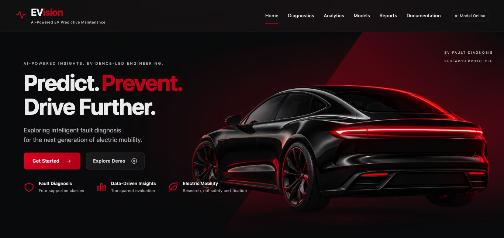
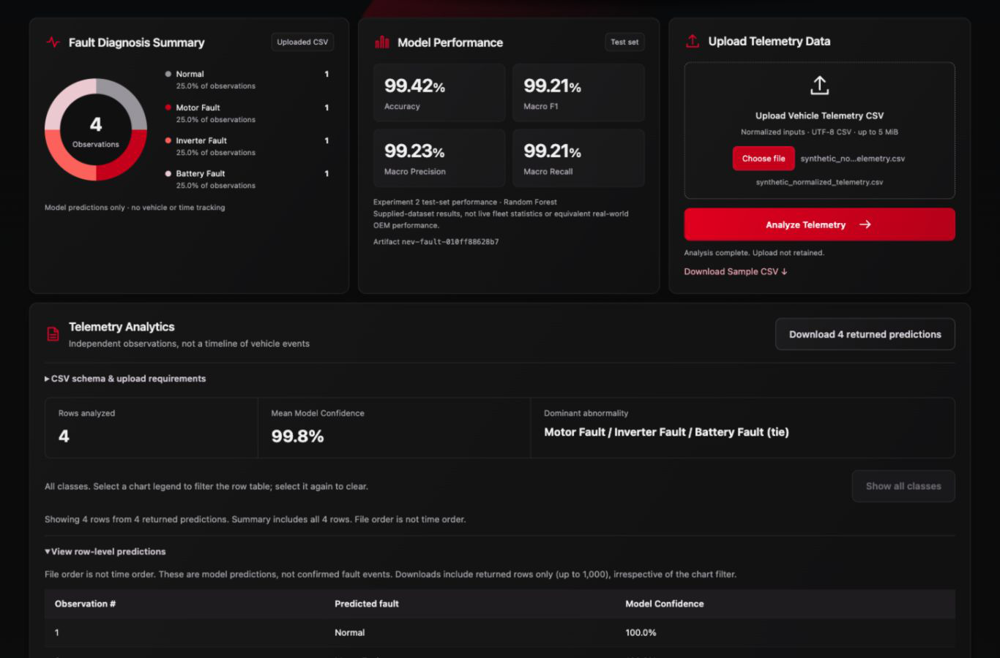
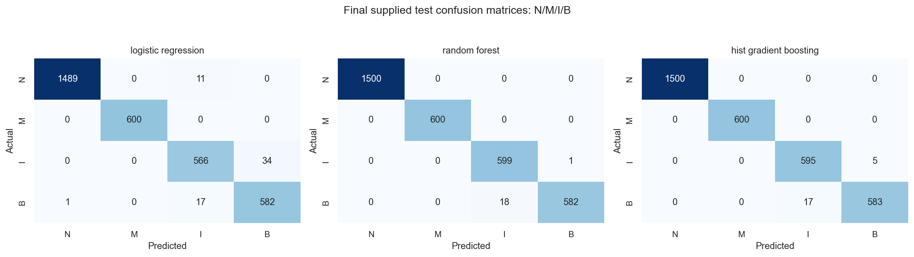

# EVision

**AI-Powered EV Fault Diagnosis | Predict. Prevent. Drive Further.**

A collaborative engineering and machine-learning research prototype that connects
EV sensor-data analysis, a saved Random Forest classifier, and an interactive web
dashboard. Developed by [Aarya Waghmare](https://github.com/AaryaWaghmare7) and
[Tejaswini Barhate](https://github.com/tejaswini-barhate).

EVision currently classifies supplied sensor observations; it is not a validated
real-world predictive-maintenance or vehicle-safety system. No production
deployment, OEM integration, or Tesla proprietary data is claimed.

## Current capabilities

- Four-class diagnosis: **Normal, Motor Fault, Inverter Fault, Battery Fault**.
- Manual prediction using seven compatible, normalized sensor inputs.
- Validated CSV batch inference and separate CSV/SQLite inspection, prediction,
  and user-confirmed evaluation workflows.
- Interactive class distributions, seven sensor histograms, boxplots, correlation
  heatmaps, scatterplots, historical feature importance, and training comparisons.
- Source-labeled CSV/JSON/HTML exports; HTML reports can be printed to PDF.
- Model readiness, actionable validation errors, and optional shared-token access.

The cinematic black-and-red interface uses local assets, responsive layouts, and
reduced-motion support. No frontend framework, Node runtime, or build is needed
to run it. **RUL and quantified maintenance risk remain unavailable.**

## Screenshots



*Actual local homepage capture from 1 November 2026, showing the single-logo hero.
Reused for this release; no new browser capture was available.*



*Earlier application capture using the included four-row sample CSV, not live
vehicle data. This image is retained as an earlier preview and needs refreshing
before the LinkedIn launch. Its sample confidence/counts are distinct from the
model's held-out test metrics. See the [capture checklist](docs/SCREENSHOTS.md).*

## Technology stack

| Layer | Technologies |
| --- | --- |
| API and validation | Python 3.13, FastAPI, Pydantic |
| Inference and analysis | scikit-learn, pandas, NumPy, joblib |
| Frontend | HTML, CSS, JavaScript, native SVG charts, local WebP illustration |
| Research and verification | Jupyter, Matplotlib, seaborn, pytest, Node's optional test runner |

Runtime versions match the approved model environment in
[requirements-api.txt](requirements-api.txt). No new dependencies are introduced
by the presentation changes.

## System architecture

```text
Manual inputs / uploaded observations
              ↓
FastAPI validation → trusted saved preprocessing + Random Forest
              ↓
Class scores and predictions → dashboard summaries and downloads

Separate analytics: actual uploaded observations or labeled NEV reference aggregates
```

One service serves both the frontend and API. The complete named-column pipeline
loads once at startup, with checksum, feature-order, class, and version checks.
Requests never train or replace it. Upload inspection can run without inference;
missing or incompatible models fail safely. See the
[architecture](docs/MODULAR_ARCHITECTURE.md).

## Machine-learning approach

The active target is **Fault Label**, mapped to 0 Normal, 1 Motor Fault,
2 Inverter Fault, and 3 Battery Fault. Inputs retain their original column names:

```text
Voltage (V), Current (A), Motor Speed (RPM), Temperature (°C),
Vibration (g), Ambient Temp (°C), Humidity (%)
```

Despite those names, values are **already normalized approximately to [0,1]**.
The original normalization parameters are unknown. Do not enter raw physical
measurements or invent a conversion; matching ranges alone do not establish
compatible preprocessing. The target never enters the model inputs.

The supplied **7,700 training / 3,300 test** split is preserved. Training-only
five-fold cross-validation selected Random Forest by macro F1 before final
evaluation. Learned preprocessing stays within each pipeline. The selected
classifier uses 200 trees and balanced class weights; its saved pipeline is
intentionally tracked at
[models/experiment_2/nev_fault_pipeline.joblib](models/experiment_2/nev_fault_pipeline.joblib).
Raw datasets are excluded from Git.

## Experiments and evaluation

### Experiment 1 — retained weak-signal findings

The EVIoT-PredictiveMaint dataset has 175,393 observations and 30 columns.
Using 24 approved operational features and a chronological 80/20 split, balanced
Logistic Regression achieved test ROC-AUC **0.4912** and Average Precision
**0.0966**. The retained Random Forest notebook experiment also showed near-chance
**validation** discrimination: ROC-AUC 0.502 and Average Precision 0.099.
Maintenance_Type signal was extremely weak; no classifier was trained for it.
These negative findings are preserved in [reports 05–07](reports/06_Failure_Signal_Analysis.md).

### Experiment 2 — supplied NEV test results

| Model | Test accuracy | Test macro F1 | Test macro OvR ROC-AUC |
| --- | ---: | ---: | ---: |
| Logistic Regression | 0.980909 | 0.975324 | 0.999191 |
| **Random Forest** | **0.994242** | **0.992082** | **0.999698** |
| HistGradientBoosting | 0.993333 | 0.990832 | 0.999759 |

The selected Random Forest achieved **99.42% accuracy and 99.21% macro F1** on
the supplied held-out NEV test dataset. Macro precision is **99.23%** and macro
recall **99.21%**. These are dataset-specific experimental results, not equivalent
real-world OEM or fleet performance.



*Rows are actual classes and columns predicted classes: Normal, Motor, Inverter,
Battery. Random Forest makes 19 errors, including 18 Battery observations labeled
Inverter. This genuine research figure is unchanged.*

Configurations, CV results, per-class metrics, and limitations are recorded in
[report 10](reports/10_NEV_Model_Comparison.md) and the
[saved evaluation artifact](reports/metrics/experiment_2/model_comparison.json).

## Run locally

Use **Python 3.13** in your selected environment, from the repository root:

```bash
python -m pip install -r requirements-api.txt
python -m uvicorn src.api.app:app --host 127.0.0.1 --port 8012
```

Open [EVision at http://127.0.0.1:8012/](http://127.0.0.1:8012/) and keep the
terminal running. Use FastAPI rather than opening `index.html` directly.
No raw dataset is needed for inference. Download the included sample CSV to try
the upload workflow.

For tests, install `requirements.txt` and run `python -m pytest -q`.
See the [development guide](docs/DEVELOPMENT_GUIDE.md) for Windows PowerShell
instructions, input contracts, verification commands, access configuration, and
safe collaboration. **No GitHub Actions CI workflow is configured yet.**

## API endpoints

| Method and path | Purpose |
| --- | --- |
| `GET /` | EVision dashboard |
| `GET /health` | Application and model status |
| `GET /ready` | Model-aware readiness: 200 when ready, 503 otherwise |
| `POST /predict-fault` | One strictly validated normalized observation |
| `POST /analyze-csv` | Strict comma-CSV batch prediction |
| `POST /analyze-dataset` | CSV/SQLite inspect, predict, or confirmed-label evaluation |
| `GET /analytics/reference` | Original NEV aggregate reference, clearly separate from uploads |
| `GET /docs` | Interactive API documentation in local mode; disabled in production mode |

Uploads are bounded to 5 MiB, 20,000 observations, and 100 columns. Returned row
predictions are capped at 1,000; whole-file analytics use all observations.
Invalid inference inputs reject the upload rather than being silently clipped
or deleted. Uploaded labels are ignored for prediction; evaluation validates
their documented mapping and requires explicit confirmation.

## Project structure

```text
src/        API, frontend, preprocessing, inference, analysis, evaluation
scripts/    Research runners, reference generation, and smoke checks
notebooks/  Preserved EDA and modeling experiments
models/     Approved inference artifact and metadata; future RUL scaffold
data/       Local datasets, excluded from Git
reports/    Numbered research reports, figures, and aggregate metrics
docs/       Architecture, setup, collaboration, and screenshot guidance
tests/      Python and frontend regression tests
```

## Contributors and responsibilities

| Contributor | Role and contribution areas |
| --- | --- |
| [Aarya Waghmare](https://github.com/AaryaWaghmare7) | **Software Engineering & Backend Development** — Python, FastAPI, API integration, application logic, ML integration, validation, testing, and repository workflow. |
| [Tejaswini Barhate](https://github.com/tejaswini-barhate) | **Data Analysis & Machine Learning** — dataset research, EDA, feature exploration, preprocessing, and ML experimentation. |

Both are undergraduate developers at Jawaharlal Nehru Engineering College,
MGM University (2024–2028). Their complete academic profiles and supplied
contribution descriptions are preserved in the
[developer profiles](docs/DEVELOPMENT_GUIDE.md#meet-the-developers) and website.

## Limitations and research integrity

- NEV class boundaries are unusually easy: a depth-3 tree reached approximately
  0.979 CV macro F1. Dataset simplicity may explain the high model scores.
- NEV has no timestamps or vehicle IDs. Temporal and cross-vehicle generalization
  are unestablished; uploaded file order is not a vehicle timeline.
- Acquisition, normalization, and label-generation protocols are unresolved;
  unknown upstream leakage cannot be ruled out.
- Model confidence is an **uncalibrated model-generated class score**, not a
  calibrated real-world failure probability. Normal does not guarantee safety;
  association and feature importance do not establish causation.
- Uploaded evaluation scores are user-attested, not independently verified
  unseen-test performance. RUL, live fleet monitoring, and OEM integration are
  not implemented.
- **NEV dataset provenance/license and trained-artifact redistribution permissions
  still require verification.** The existing tracked artifact is preserved;
  this checkpoint adds no new raw data or trained model.
- Experiment 1's Kaggle dataset is documented as CC BY-NC-SA 4.0; that license
  does not automatically apply to NEV. This project is not a published paper.
- Access controls are a shared-token, single-process boundary, not multi-user
  authentication or comprehensive production-security certification.

## Roadmap

- Verify dataset provenance, normalization, label protocols, and redistribution rights.
- Investigate real-world data with vehicle identities and observation timestamps.
- Validate uncertainty estimates and robustness to distribution shift.
- Develop component-specific RUL using verified degradation/run-to-failure data.
- Consider risk, time-series, and fleet modules only after compatible evidence
  and separate validation. No production deployment is currently claimed.

## Research reports and documentation

- Experiment 1: [baseline](reports/05_Baseline_Model_Report.md),
  [failure signal](reports/06_Failure_Signal_Analysis.md),
  [maintenance-type signal](reports/07_Maintenance_Type_Signal_Analysis.md).
- Experiment 2: [dataset audit](reports/08_NEV_Dataset_Audit.md),
  [EDA](reports/09_NEV_EDA_Report.md), [model comparison](reports/10_NEV_Model_Comparison.md).
- Application: [RUL requirements](reports/11_RUL_Dataset_Requirements.md),
  [CSV validation](reports/12_MVP_Dashboard_and_CSV_Validation.md),
  [showcase audit](reports/13_Showcase_Audit.md),
  [reliability/security audit](reports/14_Reliability_and_Security_Audit.md),
  [interactive analytics](reports/15_Interactive_Analytics.md).
- Practical guides: [development and Windows collaboration](docs/DEVELOPMENT_GUIDE.md),
  [architecture](docs/MODULAR_ARCHITECTURE.md),
  [project layout](docs/PROJECT_STRUCTURE.md), [screenshot checklist](docs/SCREENSHOTS.md).
