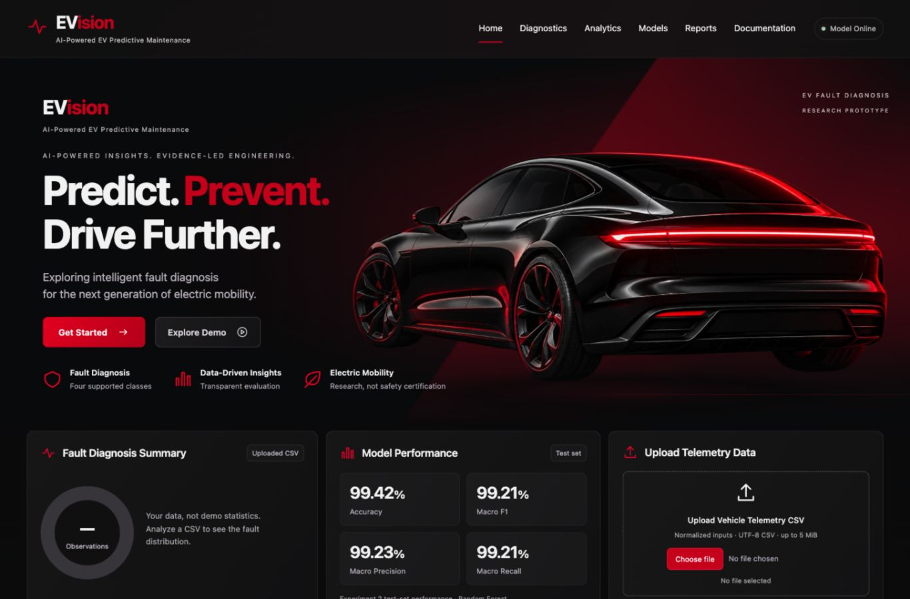
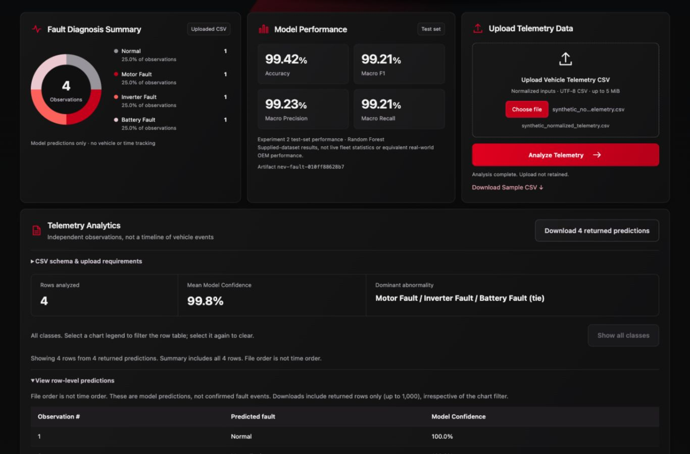

# GitHub and LinkedIn Showcase Audit

Date: 2026-10-26. Scope: audit, minimal local improvements and testing only.
No production model was fitted, no raw data changed, and no commit, push, merge,
deployment or LinkedIn post was performed.

## Outcome

**NOT READY for the combined public GitHub/LinkedIn release.** The local research
demo is functional and tested. Release gates remain: confirm NEV source/license
and permission to redistribute the trained artifact, agree a project code license,
and obtain approval to reconcile/publish the local changes. Missing RUL is not
hidden: it is explicitly Under Development and is not a showcase capability.

## Git and collaboration audit

- Local branch: `main`, HEAD `dc2ee42` (Add localhost EV fault diagnosis MVP).
- A read-only remote query followed by an approved fetch confirmed remote main
  `6577e96263829b7b23890303458503157a361b44`. Local main is **one commit behind**.
- The remote-only commit is `6577e96 Revise README for EV Predictive Maintenance
  Platform`. Its only changed file is README.md. Both README versions were read;
  the local draft retains the research overview, model comparison, future-module
  vision and collaborator context, while correcting capability claims.
- No remote history or working-tree changes were merged. A future approved
  integration must inspect both README versions and preserve legitimate work.
- Other local branch: `codex/model1-baseline` at `6405f08`. Remote tracking
  branches also retain Tejaswini's EDA/preprocessing/baseline work. None changed.
- Latest five local commits: dc2ee42, 80e70e3, 31cf906, 7aec74b, 05f6d26.
- Before this task there were 13 modified tracked files and untracked prior
  review/report/frontend-test work, plus unrelated `distribution.java` and
  `separation.java`. That work is preserved; Java files remain untouched.
- Current changes remain unstaged/uncommitted. Raw CSVs are not tracked. The
  existing 2,729,762-byte inference artifact is intentionally tracked already.

## Experiment completeness and genuine performance

### Experiment 1

Reports 03–07, feature policy, chronological splitting, baseline, retained
Random Forest notebook/audit and both signal investigations are preserved.
Failure_Probability balanced Logistic Regression: ROC-AUC 0.4912 / Average
Precision 0.0966. The notebook Random Forest's 0.502 / 0.099 values are
**validation**, not final-test scores. The Maintenance_Type investigation is
complete; no classifier was trained because signal was extremely weak.
This is useful negative evidence, not an omitted unsuccessful experiment.

### Experiment 2

Reports 08–10, supplied 7,700/3,300 split checks, training-only CV selection,
all three candidate records, selected pipeline and metadata are present.
The selected saved Random Forest was loaded and re-evaluated on every supplied
test observation, with the recorded raw-file hash checked. No `.fit()` or model
selection was run on production data. Existing metric functions were reused.

| Saved Random Forest check | Actual result |
| --- | ---: |
| Test rows / input features | 3,300 / 7 |
| Accuracy | 0.9942424242424243 |
| Macro F1 | 0.9920817441833812 |
| Macro OvR ROC-AUC | 0.9996980709876544 |
| Incorrect predictions | 19 |

Confusion matrix (actual rows / predicted columns, 0 Normal, 1 Motor, 2 Inverter,
3 Battery): `[[1500,0,0,0],[0,600,0,0],[0,0,599,1],[0,0,18,582]]`.
The recreated metrics and matrix match metadata within 1e-12. Other candidate
metrics are the preserved historical results, not newly retrained claims.

The model, metadata, metric JSON and all four raw-dataset hashes match their
previous values. Pipeline SHA-256:
`010ff88628b7d58cb3aa1f8d2430b1087e3aef1936c37082edfde7270acbe987`.
Loading is independent of working directory. Missing/corrupt/incompatible
artifacts fail safely without training or fabricated predictions. A dedicated
integration test now checks the full saved-test metrics when local raw data is
available; fresh clones still run all required artifact smoke tests without it.

The original physical normalization parameters, acquisition protocol and NEV
source/license remain unverified. The shallow-tree CV macro F1 around 0.979 and
sharp class boundaries limit realism. No timestamp/vehicle ID exists, so no
temporal, cross-vehicle, OEM-equivalent, calibrated-risk or RUL claim is made.

## App and browser checks

Confirmed through tests and a running localhost process:

- Dashboard, static assets, `/docs`, `/health`, `/ready`, `/predict-fault` and
  `/analyze-csv`. `/ready` returns 503 with an unavailable model, unlike the
  backward-compatible application-status endpoint `/health`.
- All four supplied manual samples return their expected class, with confidence
  100.0%, 100.0%, 99.0%, 100.0%, respectively. Samples fill only; Analyze remains
  explicit. These are smoke examples, not a new accuracy estimate.
- Browser invalid CSV returns a useful missing Voltage (V) message, hides stale
  results and enables retry. A subsequent valid upload succeeds.
- Valid sample upload gives four independent predictions, one per class (25%
  each), with displayed mean confidence 99.8%. This is not a time series.
- Interactive chart selection filters returned row details, opens the table,
  preserves observation numbers (Motor Fault is observation #2 in the demo),
  and leaves whole-file counts unchanged. Clear restores four rows without
  another inference request. The capped first-1,000 detail scope stays explicit.
- Actual CSS viewport widths 1366, 1024, 390 and 320 all match document width;
  navigation remains visible, with no page-level horizontal overflow. Device
  scaling was accounted for before recording CSS widths, not assumed from
  automation settings. Temporary viewport overrides are restored afterward.
- No JavaScript console errors were returned during the browser checks. Server
  responses were successful or expected validation failures, without unexpected
  tracebacks during normal use.

## Bugs/gaps corrected

1. Whole CSVs were limited only after multipart parsing. A small streaming ASGI
   guard now enforces a 6 MiB envelope before parsing consumes unbounded bytes,
   including chunked requests; the 5 MiB CSV limit remains. Manual bodies have
   a 16 KiB limit. Both declared-length and chunked rejection are tested.
2. Application health alone could appear successful while the model was absent.
   `/ready` now provides model-aware 200/503 semantics without breaking `/health`.
3. Existing distribution bars were static. Accessible toggle buttons now filter
   genuine predictions, retain counts and numbering, support reset, and disclose
   the returned-row cap. No chart library or fake data was added.
4. Mobile navigation was hidden. It now remains available in the responsive layout.
5. Full research/notebook dependencies were unnecessary for an inference service.
   `requirements-api.txt` is now the single runtime-pin source; the full research
   requirements include it. Recorded artifact versions remain unchanged.
6. README and report 10 had obsolete implementation/artifact statements. The README
   was rewritten professionally; only implementation status in report 10 changed,
   not its metrics, method or conclusions. Personal terminal troubleshooting was
   removed from the showcase README. Credits remain explicit.

UI improvements retain graphite-black/charcoal surfaces and introduce restrained
electric-blue accents, refined SVG branding, responsive navigation, consistent
interactive cards, focus states and brief result transitions. Loading states are
driven by real requests; reduced-motion preferences disable animation.
Screenshots show actual saved-model/browser results, not design mockups:

## CSV and input policy

Nine real temporary multipart file cases passed: valid, missing column,
nonnumeric, empty, harmless extra column, reordered sensors, target-free,
UTF-8 BOM/whitespace headers and deliberately wrong ignored Fault Label.
Uploads remained byte-identical. Extra metadata never enters the seven model
features; timestamp/ID columns are not interpreted as longitudinal history.
Duplicate headers, malformed records, nonfinite/range-invalid values and limits
also have regression coverage. Validation rejects the whole file before inference.
The browser supplies multipart Content-Type/boundary; JSON aliases stay strict.

## RUL and risk

Both local checkout and fetched remote main contain contracts/readme placeholders,
not a validated RUL dataset, fitted component model or risk implementation.
The collaborator's Windows dataset is not locally available/verified. RUL is
marked **Under Development**. Risk remains disabled pending compatible component,
unit/observation context and defensible thresholds. No download, extraction,
unrelated-dataset merge, regression metric, RUL estimate or risk score was invented.

## Complete test results

| Check | Result |
| --- | --- |
| Complete `python -m pytest -q` | **117 passed**, no skips in this local checkout |
| Node built-in frontend tests | **8 passed** |
| JavaScript syntax check | Passed |
| Saved model on all 3,300 supplied test rows | Reproduces recorded metrics; no fit |
| Real HTTP smoke script | Passed, including nine CSV cases and four classes |
| Browser controls/upload/filter/reset/layout | Passed as described above |
| `python -m pip check` | No broken requirements found |
| `git diff --check` | Passed |

Two existing nonblocking warnings remain: Starlette/httpx test-client deprecation
and joblib physical-core detection. Tiny synthetic unit-test fits do not retrain
the NEV artifact. No packages were installed. A clean Linux build and Windows
execution were not performed here; they remain separate portability checks.

## Security and deployment readiness — no deployment performed

Recommend **A: one Render FastAPI web service with the existing static frontend**.
This is an engineering recommendation based on the current single-origin app:
one process, one artifact and one release. Relative API URLs already work without
an environment-specific frontend base URL or CORS middleware. A Vercel split
would require explicit API-base configuration and a restricted CORS allowlist;
wildcard CORS is neither required nor added.

Prepared runtime dependencies exclude notebooks, plotting and test clients.
Documented proposed settings (not applied): `PYTHON_VERSION=3.13.9`, build
`python -m pip install -r requirements-api.txt`, start
`python -m uvicorn src.api.app:app --host 0.0.0.0 --port "$PORT" --workers 1`,
health path `/ready`. The artifact is about 2.60 MiB; raw datasets are unnecessary
for serving. No hosting account/service, secrets or auto-deploy configuration
was created. A speculative Render/Vercel configuration file is unnecessary yet.

Primary references: [Render web services](https://render.com/docs/web-services),
[Python runtime pinning](https://render.com/docs/python-version),
[HTTP readiness checks](https://render.com/docs/health-checks), and
[FastAPI CORS](https://fastapi.tiangolo.com/tutorial/cors/).

Verified safeguards: trusted startup-controlled joblib only; no model uploads;
sanitized validation errors; no HTML insertion of uploaded text; request/row/output
caps; nosniff, frame-denial and no-referrer response headers. No likely private-key
or common token patterns were found in the scoped filename-only scan; this is not
a comprehensive secrets audit. `pip check` checks compatibility, **not CVEs**.

Before public hosting: verify source/redistribution rights; run a dedicated
dependency vulnerability review and clean Linux build; measure actual memory,
concurrency and upload behavior on the chosen service; configure ingress/rate
controls and review public endpoints/docs. No load-test, exploit audit, public
traffic protection or safety certification is claimed. Authentication/database
features were not added.

## Files changed in this audit

- `README.md`, `.gitignore`, `requirements.txt`; new `requirements-api.txt`.
- `PROJECT_PLAN.md`, `DECISIONS.md`: current local-review/publication boundary.
- `src/api/app.py`: streaming byte guard, basic headers and `/ready`.
- `src/api/static/index.html`, `styles.css`, `app.js`: blue-accent polish,
  mobile navigation, chart controls and real filtering.
- `tests/api/test_fault_api.py`, `tests/prediction/test_saved_nev_model.py`,
  `tests/frontend/test_dashboard.cjs`: readiness/limits, full metric reproduction,
  dependency pins and interactive filtering tests.
- `docs/MODULAR_ARCHITECTURE.md`, `reports/10_NEV_Model_Comparison.md`,
  `src/prediction/nev_fault.py`: current implementation wording only.
- New `reports/13_Showcase_Audit.md` and two `reports/figures/showcase/` captures.

Prior local changes, report 12, experimental notebooks/reports, model artifacts
and unrelated Java files are preserved. No changes to training logic, existing
evaluation helpers, original metric JSON or raw data were made in this audit.

## LinkedIn research summary — draft only, not posted

> Tejaswini and I are developing an EV Predictive Maintenance research prototype
> that puts dataset suitability before model complexity. Our first dataset showed
> near-chance failure discrimination; we preserved those negative findings. On a
> separate supplied NEV dataset, training-only cross-validation selected Random
> Forest, with 99.42% test accuracy and 99.21% macro F1. We integrated the saved
> pipeline into a FastAPI dashboard with validated CSV uploads and interactive
> fault-class summaries. These are same-dataset proof-of-concept results—not
> real-world OEM performance. Component RUL and maintenance risk remain under
> development pending verified data and validation. This is an ongoing research
> project, not a published paper. Collaborators: Aarya Waghmare and Tejaswini.

Before posting: confirm dataset attribution/license and artifact redistribution
terms; approve collaborator wording; approve/reconcile the README-only remote
commit and publish the tested changes; ensure the linked repository matches the
screenshots. Do not imply a live hosted service, validated RUL or published paper.

**Recommendation: NOT READY for public release until those gates are resolved;
the local research demo is ready for review.**

## Subsequent collaboration approval — 2026-10-27

The user approved a GitHub collaboration checkpoint for the tested EVision
redesign so Tejaswini can pull and test on Windows. This supersedes the earlier
Git-publication approval gate; it does not establish dataset/model redistribution
rights, a project code license, production safety or cloud-deployment approval.
The earlier audit findings are historical. Current red/black branding, animation
verification and latest test counts are documented in report 12; native Windows
execution remains a collaborator validation step. No models are retrained and no
raw datasets are included in this checkpoint.
